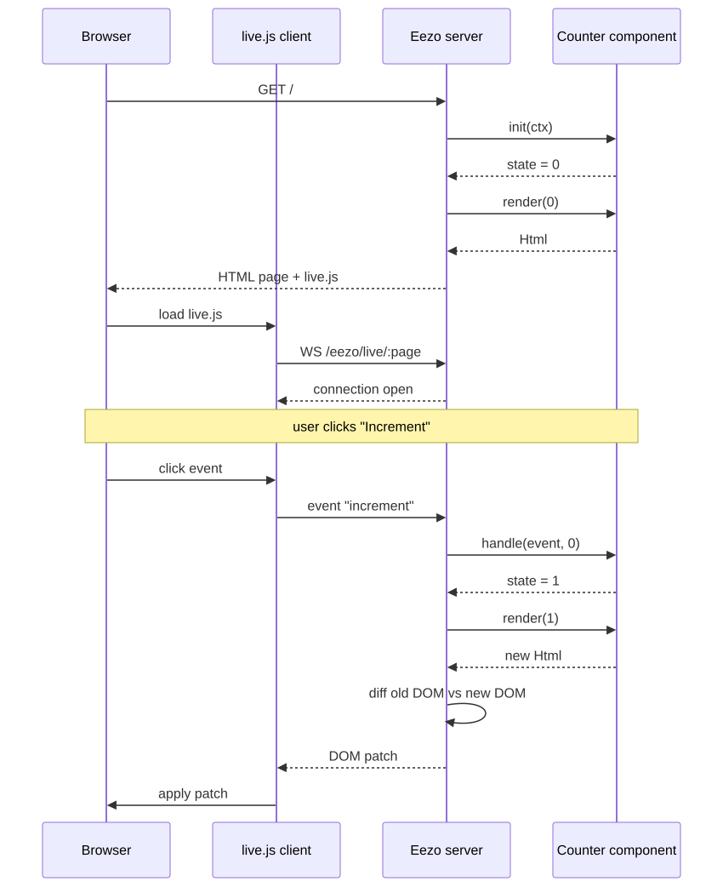
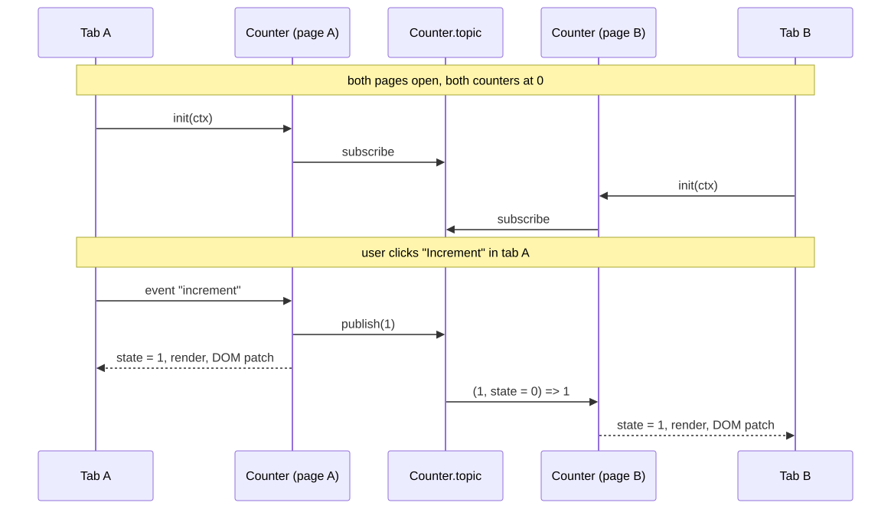

## Introduction

Eezo is a modern web framework for Scala 3 that aims to simplify web development by leveraging the latest features of the language. Eezo takes advantage of Scala 3's powerful type system, concise syntax, and functional programming capabilities to provide a seamless development experience. We took inspiration from other popular web frameworks, like [Rails](https://rubyonrails.org/), [Phoenix](https://www.phoenixframework.org/), and [Django](https://www.djangoproject.com/), while ensuring that Eezo remains idiomatic to Scala and fully leverages its unique features.

Let's use Eezo to build a simple web application and see how it simplifies common web development tasks.

## Setting Up Eezo

Eezo stores its data in Postgres. With nothing configured, it expects a database called `eezo` on `localhost:5442`, with `postgres` as both the user and password. The quickest way to get one is Docker:

```bash
docker run -d --name eezo-pg -p 5442:5432 \
  -e POSTGRES_PASSWORD=postgres -e POSTGRES_DB=eezo postgres:17
```

The port is 5442 rather than the usual 5432, so it doesn't collide with a Postgres you may already have running. If your database lives somewhere else, the `EEZO_DB_URL`, `EEZO_DB_USER`, and `EEZO_DB_PASS` environment variables point Eezo at it, as described in [Configure the database connection](https://eezo.io/docs/how-to/configure-the-database).

The best way to get started with Eezo is to install its command-line tool, which will help you create and manage Eezo projects efficiently. [Your first eezo application](https://eezo.io/docs/tutorials/getting-started) tutorial covers these first steps in more detail, and [The eezo command-line](https://eezo.io/docs/reference/cli) reference lists every command the tool offers. You can install it using the following command:

```bash
curl -fsSL https://eezo.io/install | bash
```

For this guide, we'll create a small library application. Using the Eezo command-line tool, we can quickly set up a new project:

```bash
eezo new library
```

The command above will create a new directory called `library` with all the necessary files and folder structure for an Eezo project. The folder structure will appear as follows:

```text
library-1/
├── build.sbt                      # sbt build: Scala 3.8.4, EezoPlugin, eezo 0.1.0, forked run on JDK 25
├── .gitignore                     # ignores target/, .bsp/, .metals/, .bloop/
├── project/
│   ├── build.properties           # sbt 1.12.14
│   └── plugins.sbt                # sbt-eezo 0.1.0 (route table generator, eezoDev/eezoStatus tasks)
└── src/main/scala/
    ├── Main.scala                 # entry point: object Main extends EezoApp
    ├── app/
    │   └── Index.scala            # mounts GET / and renders an "it works" page
    └── models/                    # empty, meant for case classes deriving Form/Resource/Table
```

The `build.sbt` file contains the dependencies required for our Eezo project:

```scala
libraryDependencies += "io.eezo" %% "eezo" % "0.2.0"
```

The `io.eezo.eezo` library is a shorthand for including all the core functionalities of the Eezo framework, which means the HTTP server, `io.eezo.eezo-http`, and the database integration, `io.eezo.eezo-db`. This lets us quickly start building web applications without manually including each module.

With this folder structure in place, we are ready to start building your web application using Eezo. If we execute `eezo routes`, we will see the list of routes currently defined in our application:

```bash
eezo routes
1 route:
  GET /
```

The file that defines this route is `src/main/scala/app/Index.scala`. This file mounts the GET `/` route and renders a simple "it works" page, providing a starting point for your web application. Eezo automatically picks up everything defined under the `app` directory and uses it to configure the routes and behavior of our web application. The idea was taken from Next.js, where the file system is used to define routes automatically. The file name also determines the HTTP verb for the route it defines. Again, this idea was taken from Rails, and it maps the file names as follows:

- `Index.scala` -> GET `/`
- `Create.scala` -> POST `/`
- `Update.scala` -> PUT `/`
- `Destroy.scala` -> DELETE `/`
- `Show.scala` -> GET `/:id`
- `Edit.scala` -> GET `/:id/edit`
- `New.scala` -> GET `/new`

Any other file name becomes a GET at its own lowercased segment, so `Health.scala` mounts GET `/health`, and a directory named `_id` is what gives `Show`, `Edit`, `Update`, and `Destroy` their `:id` parameter. The full set of conventions, including how handwritten routes take precedence over derived ones, is in [Routing by file layout](https://eezo.io/docs/explanation/routing) and in the [Routing conventions](https://eezo.io/docs/reference/routing) reference.

Now, we can start our Eezo web application by running the following command. It restarts the server on every save, as described in [The dev loop](https://eezo.io/docs/explanation/the-dev-loop):

```bash
eezo dev
```

The page will be available at `http://localhost:8080/` and should display the "it works" message:


Now that our Eezo web application is up and running, we can start adding more routes and functionality. First, let's move on with the next feature of our library application: managing books.

## Storing Books in the Database

In our library application, we want to manage books. Each book will have a title and an author. To achieve this, we need to define a model for the `Book` resource and set up the corresponding database table.

In Eezo, models live in `src/main/scala/models`, and we represent each one as a Scala case class. Let’s define a `Book` model as follows:

```scala
package models

case class Book(
  title: String,
  author: String
)
```

Nothing new here. Now, we want to set up the corresponding database table for the `Book` model. A model that derives `Table` will have its table automatically created and managed by Eezo:

```scala
package models

import eezo.db.Table

case class Book(
  title: String,
  author: String
) derives Table
```

If the `eezo dev` command is running, we should see an error message in the console:

```bash
[error] 8 |) derives Table
[error]   |          ^
[error]   |  Book has no `id` field. Every Eezo table needs one, e.g. `id: Id[Book]`.
[error] one error found
```

Every Eezo model that derives `Table` must have an `id` field. Let's update our `Book` model accordingly:

```scala
package models

import eezo.db.Table
import io.eezo.core.Id

case class Book(
  id: Id[Book],
  title: String,
  author: String
) derives Table
```

The `Id[T]` type represents the primary key for a table of type `T`. In our case, `Id[Book]` is the primary key for the `books` table. Eezo's default ID generation strategy automatically creates a UUID v4 for each new record. The rules that every derivation imposes on a case class, starting from the mandatory `id` field, are explained in [The case class is the source of truth](https://eezo.io/docs/explanation/the-case-class).

Now that we defined how our `Book` model maps to the database table, we need to make the framework aware of this table so that it can be created and managed properly. To do this, we need to define an object that extends the `io.eezo.db.Schema` type and declares the `books` table:

```scala
import io.eezo.db.Schema

import models.Book

object AppSchema extends Schema {
  val books = table[Book]
}
```

Usually, we put the schema definition in a place that is visible to the `Main` class, since we need to override the empty schema definition of the application:

```scala
import io.eezo.EezoApp
import io.eezo.db.Schema
import io.eezo.generated.Routes
import io.eezo.http.RouteTable

import models.Book

object AppSchema extends Schema {
  val books = table[Book]
}

object Main extends EezoApp {
  override def schema: Schema     = AppSchema
  override def routes: RouteTable = Routes.table()
}
```

Now we can look at the `eezo dev` logs again. We should notice a message coming from eezo:

```bash
[eezo] ⚠ the database does not match your models; additive only, serving anyway
1 difference(s) between model and database:

  create table book
```

Eezo connected to the database successfully and found that the schema it derived from our models does not fully match the existing database schema. In this case, it is not a destructive change, so it serves the application anyway, without the changes needed. Eezo calls this drift, and [Schema, drift and migrations](https://eezo.io/docs/explanation/schema-and-migrations) explains how the dev server decides whether a difference is additive, destructive, or risky. To apply the changes, we need to explicitly tell Eezo to update the database schema by running the following command:

```bash
eezo db sync --apply
```

Let’s break down the command into its components. The `db sync` part tells Eezo to introspect the live Postgres database, diff it against the snapshot derived from your Scala model, and render the difference as DDL. Without a flag, it only prints the diff and changes nothing. The `--apply` flag tells Eezo actually to apply the changes to the database. If the changes would have been destructive, Eezo will refuse to apply them unless explicitly instructed with a `--force` flag. The other `db` subcommands, such as `db status`, `db freeze`, and `db migrate`, are listed in [The eezo command line](https://eezo.io/docs/reference/cli) reference, and the [Change the schema](https://eezo.io/docs/how-to/evolve-the-schema) guide walks through the same workflow when a model changes.

Now that we have applied the changes to the database schema, our application should be fully in sync with the database. You can inspect the database and see that the schema was applied:

```bash
# \dt

        List of relations
 Schema | Name | Type  |  Owner
--------+------+-------+----------
 public | book | table | postgres

# \d book
              Table "public.book"
 Column | Type | Collation | Nullable | Default
--------+------+-----------+----------+---------
 author | text |           | not null |
 id     | uuid |           | not null |
 title  | text |           | not null |

Indexes:
    "book_pkey" PRIMARY KEY, btree (id)
```

Once the database schema was applied, our application is fully in sync with the database. We can proceed with the next step: implementing the CRUD operations for our `Book` model.

## Seven Routes for a Model

Now that we have our database schema in place and our application in sync with the database, we want to build a web application that lets us manage our books. Luckily, Eezo provides a convenient way to define routes for our models, which will help us implement the CRUD operations efficiently. Just let a model derive `io.eezo.http.Resource` and `io.eezo.http.Form`:

```scala
import io.eezo.db.Table
import io.eezo.core.Id
import io.eezo.http.Resource
import io.eezo.http.Form

final case class Book(
  id: Id[Book],
  title: String,
  author: String
) derives Table, Resource, Form
```

If we run `eezo dev` again (or we look at the logs if the server is already running), we should see that Eezo has automatically picked up the new routes for our `Book` model, allowing us to perform CRUD operations through the generated HTTP endpoints. The log should show entries indicating that the routes for `Book` have been registered successfully:

```bash
10 routes:
  GET /
  GET /books
  GET /books/new
  GET /books/:id
  GET /books/:id/edit
  POST /books
  PUT /books/:id
  DELETE /books/:id
```

If we point the browser to `http://localhost:8080/books`, we should see the list of books. From there, we can navigate to create a new book, view the details of a specific book, edit a book, or delete a book, all through the automatically generated web interface provided by Eezo:


It's worth noticing what the browser received to show that list. There is no JavaScript application talking to a JSON API behind it. Eezo implements server-side rendering: every page is built as HTML on the server, straight from the Scala HTML DSL, and sent to the browser ready to display. The browser has nothing to run before it can paint the list of books, which keeps the first page load fast and the pages visible to search engines. This is the same approach that [Next.js](https://nextjs.org/) brought back to the JavaScript world, and the one Rails has followed since its first release.

Now the question is, what are `Resource` and `Form` in the context of Eezo, and why do we need to derive them for our model? They answer different questions, which is why Eezo keeps them separate.

As its name says, `Form` is all about rendering each field of the case class in one \<input\> HTML element, with the input type chosen by a `Field[X]` instance for the field's Scala type: an `Int` becomes a number input, a `LocalDate` a date input, a `Boolean` a checkbox. The full table of supported types is in the [Type mappings](https://eezo.io/docs/reference/derivations) reference. It renders the whole \<form\> element, and it reads a submission back into a value of the case class. If a field is missing or cannot be parsed, it reports field by field what was missing ("is required") or what would not parse ("is not a number"). However, `Form` knows nothing about where the form posts, with which verb, what happens on success, or where the data ends up.

```scala
case class Login(email: String, password: Password) derives Form
```

A model like this has no `id`, will never be a row in a table, and mounts no route. A handwritten route will decide the rest: the path, the verb, and what a successful sign-in does. The [Write a handwritten route](https://eezo.io/docs/how-to/write-a-handwritten-route) guide shows how such a route looks.

`Resource` knows the routes. It takes a case class that already has a `Form`, requires a field named id typed `Id[Model]`, and mounts the seven CRUD routes over it.

The path is the class name in snake case, pluralized. `Resource` owns everything `Form` does not: the redirect after a successful write, the 404 for a missing row, and the 422 that sends a rejected form back with the user's typing intact. It needs the `id` field because create has to use a key before it can insert anything. `Resource` does not depend on the database layer. A model that also derives `Table` gets a store over Postgres; a model without one gets a store in memory. A project with no database in the build still mounts seven working routes. The [From a case class to seven routes](https://eezo.io/docs/tutorials/first-model) tutorial and the [Create a CRUD app](https://eezo.io/docs/how-to/create-a-crud-app) guide cover the same ground step by step, and if one of the seven routes does not do what you need, [Take over one of the seven derived routes](https://eezo.io/docs/how-to/take-over-a-derived-route) shows how to replace it with your own.

## Authentication: The `User` Model and How to Implement It

To enable authentication in your Eezo application, add a new dependency for the authentication module. What follows mirrors the [Add authentication](https://eezo.io/docs/how-to/add-authentication) guide and the [Adding sign in](https://eezo.io/docs/tutorials/sign-in) tutorial, which you can keep at hand as a reference. In your `build.sbt`, add:

```scala
libraryDependencies ++= Seq(
  "io.eezo" %% "eezo" % "0.2.0",
  "io.eezo" %% "eezo-auth" % "0.2.0"
)
```

If we run `eezo dev` after adding the dependency, we should notice a new compilation error in the console for each hand-written route and every model that derives `Resource`:

```bash
[error] -- Error: /Users/rcardin/Documents/Repositories/scala-days-2026/library-1/target/scala-3.8.4/src_managed/main/io/eezo/generated/Routes.scala:9:28
[error] 9 |    guardFor[app.Index.type]("app.Index").mounting(
[error]   |    ^^^^^^^^^^^^^^^^^^^^^^^^^^^^^^^^^^^^^
[error]   |no Guarded given for app.Index, and this application's build declares eezo-auth, so every mounted route has to say who may reach it. In its companion, one of:
[error]   |  given io.eezo.http.Guarded[T] = <yourGuard>.required
[error]   |  given io.eezo.http.Guarded[T] = io.eezo.http.Guarded.public
...
[error] 67 |        guardForModel[models.Book]("models.Book").identify,
[error]    |        ^^^^^^^^^^^^^^^^^^^^^^^^^^^^^^^^^^^^^^^^^
[error]    |no Guarded given for models.Book, and this application's build declares eezo-auth, so every mounted route has to say who may reach it. In its companion, one of:
[error]    |  given io.eezo.http.Guarded[T] = <yourGuard>.required
[error]    |  given io.eezo.http.Guarded[T] = io.eezo.http.Guarded.public
```

Again, Eezo reminds us that every route and resource must declare who can access it when authentication is enabled. This ensures that only authorized users can reach certain parts of the application. In Eezo terms, every route and resource must be guarded, meaning you must specify access control rules explicitly for each one. To do this, provide a `Guarded` instance for each route and resource, either marking it as public or requiring a specific guard. The reasoning behind this rule, and the difference between a guarded route and an owned row, is in [Guards, guarded routes and owned rows](https://eezo.io/docs/explanation/guards-and-ownership).

To keep things working for now, we can mark all routes and resources as public by providing a `io.eezo.http.Guarded` instance that uses `io.eezo.http.Guarded.public` as suggested by the error messages. This allows any user to access the routes and resources without requiring authentication, which is useful during initial development or for public parts of the application.

So, for the default `Index` route, we can mark it as public by providing a `Guarded` instance using `Guarded.public`:

```scala
package app

import io.eezo.http.Guarded

object Index {

  given Guarded[Index.type] = Guarded.public

  def index(request: Request): Response = {
    // Omissis
  }
}
```

For the `Book` resource, we can do the same:

```scala
package models

import io.eezo.http.Guarded

object Book {
  given Guarded[Book] = Guarded.public
}
```

A new compilation of our app should remove the previous errors and let the application run without authentication-related issues for the public routes and resources.

Every web application needs a way to manage users and their authentication. In Eezo, this typically involves creating a `User` model that represents the users of your application. Users need to be stored in the database, so first we define the `User` model with the necessary fields and derive the appropriate type classes:

```scala
package models

import io.eezo.auth.Password
import io.eezo.db.Table

final case class User(
  id: Id[User],
  username: String,
  password: Password
) derives Table
```

The above is the bare minimum definition of a `User` model in Eezo. It includes an `id` field for uniquely identifying each user, a `username` for the user's login name, and a `password` field that uses Eezo's `Password` type for secure password handling. The `Password` type is an `opaque type` over `String` that holds bcrypt hash and nothing else. It uses a bcrypt at a fixed cost of 12 with a `$2b` salt.

If we try to run `eezo dev` at this point, Eezo will return an error:

```bash
[error] 11 |) derives Table
[error]    |          ^
[error]    |No database mapping for io.eezo.auth.Password$package.Password at field `password`.
[error]    |
[error]    |Provide one in scope:
[error]    |  given Column[io.eezo.auth.Password$package.Password] = Column[String].imap(...)(...)
```

Fortunately, Eezo errors are quite descriptive and guide you towards the solution. In this case, it tells us that there is no database mapping for the `Password` type and even suggests how to provide one in scope. Eezo comes with many built-in mappings for common types, like `String`, `Int`, and `Boolean`, but for custom types like `Password`, you need to define your own mapping. The easiest way to define a new column mapping is to start from an already existing mapping for a similar type, such as `String`, and then use the `imap` method to convert between the database type and your custom type, and back. It's a good practice to place such mappings in a companion object or a dedicated file for database mappings. The [Type mappings](https://eezo.io/docs/reference/derivations) reference lists the built-in mappings and shows the same `imap` recipe for custom types.

```scala
import io.eezo.db.Column

object User {
  given Column[Password] = Column[String].imap(Password.stored)(_.value)
}
```

Now that we've fixed the database mapping for the `Password` type, we need to let Eezo create the corresponding database table for the `User` model. First, we need to register the `User` model among the available schemas:

```scala
object AppSchema extends Schema {
  val books = table[Book]
  val users = table[User] // <== Added the User table to the schema
}
```

Let's run the migration command once again:

```bash
eezo db sync --apply
```

The above command should have created the necessary database table for the `User` model, applying the schema changes defined by the `Table` derivation. You can now verify that the table exists in your database:

```bash
eezo=# \dt
        List of relations
 Schema | Name | Type  |  Owner
--------+------+-------+----------
 public | book | table | postgres
 public | user | table | postgres
(2 rows)

eezo=# \d "user"
               Table "public.user"
  Column  | Type | Collation | Nullable | Default
----------+------+-----------+----------+---------
 id       | uuid |           | not null |
 password | text |           | not null |
 username | text |           | not null |
Indexes:
    "user_pkey" PRIMARY KEY, btree (id)
```

Next, let's add a user to the table using an `INSERT` statement:

```sql
insert into public."user" ("id", "name", "password") values
  ('b373da80-9b47-4326-9042-9b0175431235', 'admin',  '$2b$12$xx4SRIIHYVtV3dTH9tRLwe.a/cpgykhXlT9YzWiqtPvubfHKx/uZO');
```

The statement above inserts a new user called `admin` with the password `qwerty`. Please don't use it in production environments.

Now that the user is in the database, it's time to add the missing functions to our application to retrieve and manage users. The best way to tackle this is to provide the full code now, then explain it step by step. So, the code to add to the `User` object is as follows:

```scala
import io.eezo.auth.{Guard, Password}
import io.eezo.core.Id
import io.eezo.core.html.Url
import io.eezo.db.*
import io.eezo.db.Scopes.read

object User {

  given Column[Password] = Column[String].imap(Password.stored)(_.value)

  def byUserName(username: String): Option[User] = {
    read(Table[User].where(_.username === username).first())
  }

  given guard: Guard[User] = Guard[User](
    find = id => read(Table[User].findById(id)),
    credentials = username => byUserName(username).map(user => (user.id, user.password)),
    home = Url.Mounted("/books")
  )
}
```

Let's break down the code added to the `User` object. First, the `byUserName` function. It is a helper function that retrieves a user from the database by username. It uses the Eezo DSL for querying the database. As we can see, the `Table` type provides a convenient way to interact with the underlying database tables, allowing us to construct queries in a type-safe manner. The interesting part is the use of the `read` scope, which ensures that the database read operation is performed within the appropriate context. It uses Scala 3 capabilities under the hood. In detail, it opens a read-only database scope, preventing inappropriate mixing of read and write operations. In fact, if we try to run a write operation within a read scope, the compiler catches it, preventing potential runtime errors and maintaining the integrity of our database operations. The query DSL and the `read` and `transact` scopes are described in [The database layer](https://eezo.io/docs/explanation/the-database-layer).

The `Guard` type is the Eezo authentication module's way of handling user authentication. It provides a structured way to define how users sign in, how they're authorized, and where they should be redirected after a successful login.

In our code, we define a given instance of `Guard[User]` with three main components. The first is the `find` function. Its job is to turn the user key stored in the session cookie back into a full `User` row on every guarded request. The second is the `credentials` function. The guard calls it once, at login, with whatever the login form sent as the identifier. Lastly, the `home` function defines the URL to redirect the user to after a successful login when the visitor didn't arrive via a refused page. You might wonder why we didn't use a simple `String` for the home URL. The `Url.Mounted` type allows us to mount the endpoint within a prefix if needed, making it easier to manage routes and maintain consistency across the application. For example, we can decide to mount our routes under an `/admin` prefix and a `/v1` versioning prefix, as shown below:

```scala
val nested = Route.under("/admin")(Route.under("/v1")(myRoutes))
```

In this example, if `myRoutes` also contains the `/books` route, it will be accessible at `/admin/v1/books`. How a mount rewrites every `Url.Mounted` value in a response is explained in [URLs as values, and what a mount moves](https://eezo.io/docs/explanation/urls-and-mounts), and the [Mount routes under a prefix](https://eezo.io/docs/how-to/mount-under-a-prefix) guide gives a worked example.

Now that we defined our `Guard[User]` and understood how to mount routes, we can proceed to bind it to our application's routing system. For example, we want to protect the `/books` route. The only thing we need to do is change the `Guard` instance used by the `Book` model:

```scala
object Book {
  given Guarded[Book] = User.guard.required
}
```

If we run the `eezo dev` command again, we should now see three new routes appearing in the log:

```bash
13 routes:
  GET /login
  POST /login
  POST /logout
```

The authentication routes appear because we used the `User.guard.required` instance in our `Book` model, which triggers the inclusion of the login and logout routes automatically. If we point our browser to `/login`, we should see the login page rendered by the framework. Behind that page, the session cookie and the CSRF token are handled by the framework, as described in [Sessions, flash and the CSRF token](https://eezo.io/docs/explanation/sessions-and-csrf).


With authentication in place, there is one last pillar of Eezo we showed at Scala Days: the UI.

## Live Components: Keeping Pages in Sync

So far, every page we served was plain HTML: the browser asks, the server answers, and that's it. The last feature we want to show is Eezo's reactive UI. Eezo offers server-side rendered components with a React-style shape, borrowing the model of [Phoenix LiveView](https://www.phoenixframework.org/): the state lives on the server, the browser is a thin renderer, and the framework ships the little JavaScript it needs. We will not write a line of JavaScript of our own.

Let's build the standard counter component. Components live in the `src/main/scala/components` directory, and each one is a class that extends `io.eezo.live.Component` with a type parameter for its state. The state can be a case class, a number, or anything else we like. For a counter, an `Int` is enough:

```scala
package components

import io.eezo.core.html.*
import io.eezo.live.{Component, Event, Init, Live}

class Counter extends Component[Int] {

  override def init(ctx: Init[Int]): Int = 0

  override def handle(event: Event, state: Int): Int = event.name match {
    case "increment" => state + 1
    case _           => state
  }

  override def render(state: Int): Html =
    div(
      p(s"Count: $state"),
      button("Increment", Live.onClick("increment"))
    )
}
```

Every component has the same API, made of three functions:

- `init` gives the initial state of the component. Our counter starts at zero.
- `handle` is a state transition: the current state plus an event equals the new state. Nothing else.
- `render` turns a state into HTML. The framework calls it whenever the state changes.

Nothing is mutable, and there is no `setState` to call. Given a state, we get new HTML, which makes it what React calls a pure component.

The `render` function uses the HTML DSL we already met in the `Index` page: importing `io.eezo.core.html.*` gives us a function per tag, so `div`, `p`, and `button` build the tree directly in Scala. The interesting part is `Live.onClick("increment")`. It is an attribute like any other, and it binds the button click to an event called `increment`. When the user clicks, the event reaches the server, and `handle` pattern matches on its name. The event is not a JavaScript thing. It is a Scala value, and it can carry data from the browser if we need it to.

Now we need to put the counter on a page. A component is mounted inside an ordinary page, served by an ordinary route, through `Live.mount`. Let's add it to our home page:

```scala
package app

import io.eezo.core.html.*
import io.eezo.http.{Guarded, Request, Response}
import io.eezo.live.Live

import components.Counter

object Index {

  given Guarded[Index.type] = Guarded.public

  def index(request: Request): Response =
    Response.Ok(
      Html.doctype ++ html(
        head(meta(Attrs.charset := "utf-8"), title("Library")),
        body(
          h1("it works"),
          Live.mount(request, new Counter)
        )
      )
    )
}
```

The `Live.mount` function takes two things: the request we are answering and the component. The request is there because a page served behind a guarded route is bound to the user who rendered it, and only that user's browser may connect to it. Our home page is public, so there is nothing more to do. If we run `eezo dev` and open `http://localhost:8080/`, we find the counter under the "it works" message, and clicking the button increments it without any page reload. The [Add a live component](https://eezo.io/docs/how-to/add-a-live-component) guide covers the same wiring in a few steps.

It's worth stopping for a moment to understand how the UI is actually rendered. When we open the page, we don't get only the HTML Eezo renders. We also get a WebSocket. The browser pushes events to the server through it; the server runs the `handle` function, renders the new state, computes a diff between the old DOM and the new one, and sends that diff back. The thin JavaScript client in the browser applies the patch, and the page is updated. This is why, if we pay close attention to the `eezo dev` boot log, we find a `WS /eezo/live/:page` route and a `GET /eezo/live.js` route that we never defined: they are the framework's, and they open the bidirectional channel between the browser and the server. The details of what travels over the socket are in [The live layer](https://eezo.io/docs/explanation/the-live-layer).

The following sequence diagram sums up the whole round trip, from the first HTTP request to the DOM patch applied after a click on the button:



The counter works, but it is isolated to each page, which has its own state. So, two tabs on our home page are two independent counters. Eezo has a little pub/sub built into its UI, called `Topic`, that lets multiple pages subscribe to the same channel and stay in sync. Let's give our counter a topic in its companion object and wire it in:

```scala
package components

import io.eezo.core.html.*
import io.eezo.live.{Component, Event, Init, Live, Topic}

object Counter {
  val topic: Topic[Int] = Topic[Int]
}

class Counter extends Component[Int] {

  override def init(ctx: Init[Int]): Int = {
    ctx.subscribe(Counter.topic)((newValue, state) => newValue)
    0
  }

  override def handle(event: Event, state: Int): Int = event.name match {
    case "increment" =>
      Counter.topic.publish(state + 1)
      state + 1
    case _ => state
  }

  override def render(state: Int): Html =
    div(
      p(s"Count: $state"),
      button("Increment", Live.onClick("increment"))
    )
}
```

Two things changed. In `init`, the counter still starts at zero, but it also subscribes to the topic. The function we pass to `subscribe` is itself a state transition: it receives the published value and the current state, and returns the new state. Here we take the value that was published. In `handle`, whenever we receive the `increment` event, we publish the new value on the topic and then return it as the new state, which triggers a new render of the page. Every other page subscribed to the topic receives the value and updates its own state, keeping all of them in sync.

Here is the same flow as a sequence diagram, with two tabs open on the home page and a click on the button in the first one:



Let's see it at work. If we run `eezo dev`, open the home page, and duplicate the tab, we can click the button in one tab and watch the counter move in the other:


The state propagated on the server and was hydrated back into the other page. No extra HTTP requests, no server-sent events, no JavaScript of our own: just one WebSocket per page. For the full pattern, including lists that other pages reorder, have a look at [Share state between live pages](https://eezo.io/docs/how-to/share-state-between-pages), and at the [A live page, from nothing](https://eezo.io/docs/tutorials/a-live-page) tutorial for a longer walkthrough of the live layer.

## Conclusion

In conclusion, with a bunch of case classes and a few derivations, we built what is probably 80% of a standard CRUD application: a model stored in Postgres, seven routes to manage it, a login form with session cookies and guarded pages, and a live component that keeps every open tab in sync. All by hand, with no SQL, no HTML templates, and no JavaScript written by us.

The remaining step is to put it online. Eezo ships with a deploy command that targets [Fly.io](https://fly.io/) with sensible defaults, so an `eezo deploy` should be enough to have the application running on the cloud in a couple of minutes. The [From nothing to Fly.io](https://eezo.io/docs/tutorials/deploy-to-fly) tutorial covers it.

Eezo is young, and we would love to hear what you build with it. The [documentation site](https://eezo.io/docs) is the place to start, and the sources are on [GitHub](https://github.com/Eezo-framework/eezo).
